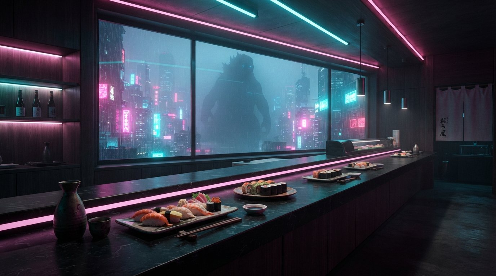

# 🦖 KAIJU 怪獣 · Vegan Sushi Bar

Web ficticia de un sushi bar 100 % vegetal en Malasaña (Madrid) con estética futurista de neón y homenaje al género kaiju. Proyecto de portfolio centrado en animación, interacción y funcionalidad.

**🔗 [Ver la web en vivo](https://sergioperez3.github.io/KAIJU/)**

## ✨ Funcionalidades

- **Intro cinematográfica hecha con código** (sin vídeo, todo en HD):
  - Lluvia en `canvas`, niebla en capas, relámpagos aleatorios y ojos del kaiju que se encienden con el scroll.
  - HUD futurista con nivel de alerta, distancia y una mira que fija al monstruo.
  - "Vuelo" de cámara con zoom y desenfoque que se funde con la barra del restaurante.
- **Carta interactiva por categorías** (Sushi, Ramen, Entrantes y Postres): el color de neón de toda la web cambia con cada plato, los ingredientes flotan sobre la foto, el título se descifra con efecto *scramble* y hay nivel de picante "alerta 1-5", alérgenos e inclinación 3D.
- **Bandeja de pedido**: animación del plato volando a la bandeja, cantidades, total y pedido para recoger.
- **Reto Kaiju Roll**: un ojo gigante se abre con el scroll, alerta roja con temblor de pantalla y cuenta atrás de 25 minutos.
- **Reservas funcionales**: calendario (lunes cerrado), horas ocupadas, zona (Barra, Mesa o Búnker), comensales, formulario, confirmación con código, exportación a calendario (`.ics`) y botón para llamar.
- **Contacto**: indicador "Abierto/Cerrado ahora" calculado con la hora real, llamada directa y mapa de Google Maps.
- Diseño responsive con ajustes específicos para móvil.

## 🛠️ Tecnologías

HTML5, CSS3 (clip-path, blend modes, custom properties, sticky) y JavaScript vanilla, sin frameworks: `canvas` para la lluvia, `IntersectionObserver`, Web Animations API y generación de archivos `.ics` con `Blob`.

## 🎨 Imágenes

Generadas con IA (Google Gemini) a partir de prompts diseñados para mantener el mismo estilo de neón en todos los platos.

---

Restaurante ficticio · Teléfono, precios y reservas simulados · Diseño y desarrollo: **Sergio Pérez**
